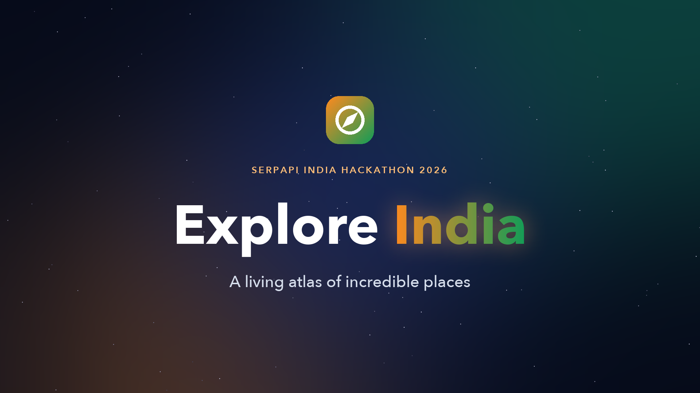

<div align="center">

# 🇮🇳 Explore India

### Discover destinations. Find hidden gems. Experience India.

An AI-powered tourism discovery platform for exploring India's
destinations, attractions, and lesser-known places through an
interactive map.

<p align="center">
  
</p>
<p>
  <b>Discover places • Explore photos and reviews • Watch travel videos • Find nearby attractions</b>
</p>

</div>

------------------------------------------------------------------------

## 📌 About the Project

**Explore India** is a map-first tourism discovery platform designed to
help travelers discover popular destinations and hidden gems across
India. Users can explore places geographically, view tourism
information, discover photos and visitor reviews, watch relevant travel
videos, and find nearby attractions.

The project begins with destinations in Karnataka, with the vision of
expanding across India and eventually supporting destinations worldwide.

## 🎬 Project Demo

<div align="center">
  <a href="assets/explore-india-demo.mp4">
    
  </a>
  <p><em>▶️ Click the thumbnail above or the link below to watch the demo video walkthrough</em></p>
</div>

> 🎥 **Demo Video:** [`assets/explore-india-demo.mp4`](assets/explore-india-demo.mp4)  
> 🖼️ **Thumbnail:** [`assets/explore-india-thumbnail.png`](assets/explore-india-thumbnail.png)

## 🖼️ Screenshots

<!-- Replace the example filenames below with your own screenshots. -->
  -------------------------------------------------------------------------------------
  Interactive Map                      Destination Details
  ------------------------------------ ------------------------------------------------
     details](assets/explore-india-destination.png)

  -------------------------------------------------------------------------------------

  ----------------------------------------------------------------------------------
  Tourist Spot Details                      Photos and Videos
  ----------------------------------------- ----------------------------------------
     media](assets/explore-india-media.png)

  ----------------------------------------------------------------------------------

## ✨ Key Features

### 🗺️ Interactive, Map-First Discovery

-   Explore destinations and attractions on an interactive map.
-   Navigate from broad destinations to individual tourist spots.
-   Select a destination or spot to view its details.

### 📍 Destinations and Tourist Spots

-   Discover temples, historical landmarks, beaches, waterfalls, hill
    stations, wildlife areas, nature spots, cities, food destinations,
    cultural attractions, and UNESCO-related sites.
-   Keep destinations and individual attractions as separate entities.
-   Organize spots by location and category.

### 📸 Photos and Visitor Reviews

-   View photos associated with tourist spots.
-   Explore visitor ratings and reviews where data is available.
-   Store retrieved information in the application database to reuse it
    across visits.

### 🎥 Travel Videos

-   Find relevant travel guides, documentaries, history videos, vlogs,
    and walking tours.
-   Associate video content with the relevant destination or tourist
    spot.
-   Avoid duplicate video records when refreshing content.

### 🧭 Nearby Attractions

-   Discover places near a selected destination or tourist spot.
-   Use geographic context to help plan further exploration.

### 🤖 AI-Assisted Discovery

-   Help classify tourism places and organize categories.
-   Support contextual recommendations and travel-related responses.
-   Use retrieved data as grounding; AI should not invent ratings,
    coordinates, reviews, or video statistics.

### ⚡ Database-First Data Flow

-   Check PostgreSQL for existing information before making external API
    requests.
-   Fetch and store missing or stale information when appropriate.
-   Reuse cached data to reduce unnecessary external API calls.
-   Update existing records and avoid duplicates during synchronization.

### 🔐 Admin Dashboard

-   Provide protected administration for managing tourism content.
-   Support adding, editing, and approving spots.
-   Manage associated photos, reviews, videos, and nearby places.
-   Require server-side authentication and authorization for
    administrative actions.

## 🧱 Technology Stack

  -----------------------------------------------------------------------
  Technology                          Purpose
  ----------------------------------- -----------------------------------
  Next.js                             Application framework and
                                      server-side routes

  React                               User interface

  TypeScript                          Type-safe application development

  Tailwind CSS                        Styling and responsive layouts

  PostgreSQL / Neon                   Persistent application database

  Prisma                              Database ORM and schema management

  Leaflet                             Interactive maps

  MapTiler                            Map tiles and geographic
                                      visualization

  SerpApi                             External tourism, place, review,
                                      photo, and video discovery

  OpenAI API                          AI-assisted classification and
                                      contextual recommendations

  Neon Auth                           Application authentication
  -----------------------------------------------------------------------

*This list describes the project's intended/current technology
direction; individual features may depend on their implementation status
in the codebase.*

## 🏗️ High-Level Architecture

``` text
                    Explore India
                         |
             Next.js / React Application
                         |
              Application API / Services
                  /              \
         PostgreSQL / Neon       AI Services
                  |                  |
        Destinations and Spots   OpenAI API
        Photos and Reviews
        Videos and Categories
                  |
          Data Synchronization
                  |
                SerpApi
```

### Data Strategy

1.  Search the application database first.
2.  If information is missing or requires refreshing, request it from
    the relevant external source.
3.  Normalize and validate the retrieved information.
4.  Associate it with the correct destination or spot.
5.  Insert new records or update existing records without creating
    duplicates.
6.  Return the saved application data to the user interface.

External API keys must remain on the server and must not be exposed in
client-side code or committed to the repository.

## 🗂️ Tourism Categories

Explore India is designed to support categories such as:

-   Historical
-   Temples
-   Waterfalls
-   Beaches
-   Hill Stations
-   Wildlife
-   Nature
-   Adventure
-   Cities
-   Food
-   Culture
-   UNESCO

## 🚀 Getting Started

### Prerequisites

-   Node.js and npm
-   A PostgreSQL database, such as Neon
-   API keys for the external services used by your configured features

### Installation

``` bash
git clone https://github.com/gopinathchinnaraj/explore-india.git
cd explore-india
npm install
```

Create a `.env.local` file in the project root and configure the
environment variables required by your implementation. Example:

``` env
DATABASE_URL="your-postgresql-connection-string"
SERPAPI_API_KEY="your-serpapi-key"
OPENAI_API_KEY="your-openai-api-key"
NEXT_PUBLIC_MAPTILER_KEY="your-maptiler-key"
NEXT_PUBLIC_APP_URL="http://localhost:3000"
CACHE_TTL_HOURS="24"
```

If Neon Auth is enabled, add its required server-side configuration
according to the integration used in your project.

> **Security:** Never commit `.env.local`, database credentials,
> authentication secrets, or private API keys. Use `.env.example` with
> empty placeholder values if you want to document the required
> variables.

### Database Setup

Run the Prisma commands appropriate for your repository and schema. For
a project using Prisma migrations:

``` bash
npx prisma generate
npx prisma migrate dev
```

If your project uses a different database setup or deployment workflow,
follow its existing configuration rather than running migrations
blindly.

### Run Locally

``` bash
npm run dev
```

Open <http://localhost:3000> in your browser.

## 🔒 Authentication and Administration

The normal application is intended for browsing approved tourism
content. Administrative actions should be restricted to authenticated
users with the appropriate admin role.

-   **Authentication** verifies who the user is.
-   **Authorization** determines which actions the user is allowed to
    perform.
-   Protect admin pages and admin API routes on the server; hiding a
    link in the UI is not sufficient.
-   Do not store plain-text passwords in application tables.

## 🛣️ Roadmap

-   [ ] Improve search across destinations and individual spots.
-   [ ] Expand destination and spot coverage across India.
-   [ ] Complete automated photo, review, and video enrichment for newly
    discovered places.
-   [ ] Add reliable data freshness checks and duplicate prevention.
-   [ ] Improve nearby-place discovery.
-   [ ] Enhance AI-powered recommendations and itinerary planning.
-   [ ] Continue improving the protected admin dashboard.
-   [ ] Add favorites and personalized trip planning.

## 🤝 Contributing

Contributions, suggestions, and bug reports are welcome. For significant
changes, open an issue first to discuss the proposed improvement. Keep
changes focused and avoid exposing secrets or personal credentials.

## 👨‍💻 Author

**Gopinath C.**

-   GitHub: [@gopinathchinnaraj](https://github.com/gopinathchinnaraj)
-   LinkedIn:
    [gopinathchinnaraj](https://linkedin.com/in/gopinathchinnaraj)

## 📄 License

No license has been specified yet. Add a `LICENSE` file before
presenting the project as open source under a particular license.

------------------------------------------------------------------------

<div align="center">
  <b>Explore India 🇮🇳 — Your next discovery is on the map.</b>
</div>
